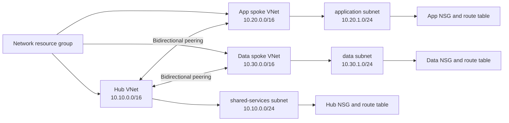

# Azure Secure Hub-and-Spoke Terraform Reference

> **Reference only:** This repository contains a validation-focused architecture example. It is not a deployed development, test, staging, or production environment, and it has not been verified by planning or applying against an Azure subscription.

This Terraform reference models a small Azure hub-and-spoke network with deterministic names, stable map keys, subnet-level security and routing attachment points, and bidirectional virtual network peerings. It is intentionally compact enough to study and extend without implying that the defaults are production-ready.

## Architecture



The default reference topology creates:

- One resource group, one hub VNet, and two stable-key spoke VNets (`app` and `data`).
- Three subnets: hub `shared-services`, spoke `application`, and spoke `data`.
- One NSG and one route table associated with every subnet.
- Four peering resources, one in each direction for each hub-to-spoke relationship.
- Root outputs for the hub VNet ID, spoke VNet IDs, and nested subnet IDs.

Every peering direction enables `allow_virtual_network_access`. It disables `allow_forwarded_traffic`, `allow_gateway_transit`, and `use_remote_gateways`.

## Security posture

The NSGs contain no custom security rules. They retain only Azure platform default rules, so they are structural attachment points and **not production segmentation policy**. In particular, the reference does not define workload-specific sources, destinations, ports, application security groups, or explicit egress controls.

The route tables contain no custom routes. They are structural attachment points and **not production routing policy**. The reference does not provide forced tunneling, a network virtual appliance, Azure Firewall, gateway propagation design, or a verified next-hop path.

Before adapting this design for a real environment:

- Define least-privilege inbound, east-west, and outbound traffic rules from documented application flows.
- Define and test routing, DNS, egress, inspection, and failure behavior.
- Add governance appropriate to the organization, such as tags, resource locks, Azure Policy, and change controls.
- Add private connectivity, DDoS protection, firewalling, gateways, or other controls only where requirements justify them.
- Validate overlapping address-space constraints against on-premises networks and every connected Azure network.

## Identity and Azure prerequisites

Local formatting, initialization with the backend disabled, validation, tests, linting, and configuration scanning require no Azure login or subscription ID.

A future deployment outside this repository would require all of the following:

- An Azure subscription selected through an approved external authentication workflow. Do not place credentials, tenant IDs, client secrets, or subscription IDs in this repository.
- A Microsoft Entra workload identity, managed identity, or other approved identity with only the control-plane permissions required to create the resource group and listed network resources. Azure's Network Contributor role can manage network resources but does not by itself establish the full least-privilege permission set for creating the resource group; prefer a reviewed custom-role and scope design where practical.
- The required Azure resource providers, including `Microsoft.Network`, registered in advance. The provider configuration deliberately sets `resource_provider_registrations = "none"`.
- A reviewed remote-state backend, state encryption and access controls, locking strategy, change approval, and rollback plan. This repository intentionally defines no backend.

See the [Azure built-in roles reference](https://learn.microsoft.com/azure/role-based-access-control/built-in-roles) and [Azure provider authentication guidance](https://registry.terraform.io/providers/hashicorp/azurerm/latest/docs#authenticating-to-azure) before designing deployment access.

## Optional monitoring and diagnostics

Diagnostics are deliberately out of scope. A production adaptation should evaluate:

- Exporting the Azure Activity Log to an approved Log Analytics workspace, storage account, or event hub.
- Azure Monitor diagnostic settings for resources that expose required log or metric categories.
- Azure Network Watcher virtual network flow logs and Traffic Analytics where traffic evidence is required. Do not design a new implementation around NSG flow logs; Microsoft has stopped new NSG flow-log creation and documents their retirement.
- Alerting, retention, access, data residency, and incident-response requirements before collecting telemetry.

Useful primary references include [Azure Activity Log](https://learn.microsoft.com/azure/azure-monitor/platform/activity-log), [Azure Monitor diagnostic settings](https://learn.microsoft.com/azure/azure-monitor/platform/diagnostic-settings), and [virtual network flow logs](https://learn.microsoft.com/azure/network-watcher/vnet-flow-logs-overview).

## Cost considerations

This reference contains no cost estimate. Likely cost drivers in an adapted deployment include VNet-peering data transfer, diagnostic data ingestion and retention, flow-log storage and analytics, and any added services such as Azure Firewall, VPN or ExpressRoute gateways, Bastion, NAT Gateway, public IP addresses, or DDoS Network Protection. Region, traffic direction and volume, retention, and pricing tier materially affect cost. Review the current [Azure Virtual Network pricing](https://azure.microsoft.com/pricing/details/virtual-network/) and [Azure Monitor pricing](https://azure.microsoft.com/pricing/details/monitor/) before deployment.

## Inputs and outputs

| Input | Default | Purpose |
| --- | --- | --- |
| `location` | `eastus` | Azure region for all reference resources. |
| `name_prefix` | `contoso-platform` | Human-readable prefix normalized to lowercase hyphenated names. |
| `hub_cidr` | `10.10.0.0/16` | Hub VNet IPv4 CIDR. |
| `spokes` | `app` and `data` map | Stable spoke keys, VNet CIDRs, and subnet maps. |

The root validations require valid, trimmed IPv4 CIDRs; non-overlapping hub and spoke ranges; non-overlapping spoke ranges; spoke subnets contained within their VNet; and non-overlapping subnets within each spoke.

| Output | Purpose |
| --- | --- |
| `hub_vnet_id` | Resource ID of the hub VNet. |
| `spoke_vnet_ids` | Stable spoke keys mapped to VNet IDs. |
| `subnet_ids` | Hub and stable spoke keys mapped to subnet IDs. |

## Reference-only basic example

[`examples/basic/main.tf`](examples/basic/main.tf) demonstrates a caller with explicit non-overlapping CIDRs. It is reference-only, contains no credentials or subscription ID, and is not evidence of an Azure deployment.

The safe local verification path does not contact Azure:

```powershell
terraform fmt -check -recursive
terraform init -backend=false -input=false
terraform validate -no-color
terraform test -no-color
tflint --init --config "$PWD/.tflint.hcl"
tflint --config "$PWD/.tflint.hcl" --format compact
trivy config --severity HIGH,CRITICAL --exit-code 1 --skip-dirs .terraform --skip-dirs .tools .
```

To validate the example independently without credentials:

```powershell
terraform -chdir=examples/basic init -backend=false -input=false
terraform -chdir=examples/basic validate -no-color
```

## CI and dependency maintenance

The GitHub Actions workflow uses top-level `contents: read`, requests no OIDC permission, consumes no repository secrets, and runs formatting, backend-disabled initialization, validation, Terraform tests, TFLint, and Trivy configuration scanning. Every `uses:` entry is pinned to an immutable 40-character commit SHA with a readable release comment.

Dependabot checks GitHub Actions and Terraform dependencies weekly. Dependency updates still require review and the same local validation.

## Limitations and verification boundary

- No Azure login, backend initialization, plan, apply, deployment, or billable cloud operation was performed for this reference.
- No live connectivity, effective NSG, effective route, DNS, failover, performance, availability-zone, or policy behavior was tested.
- The reference has no workloads, private endpoints, DNS zones, firewall, gateway, NAT, DDoS plan, monitoring resources, or operational runbooks.
- Peering permits direct VNet access but intentionally does not support transitive routing or gateway transit.
- NSGs and route tables are empty structural components, not production security or routing controls.
- The module creates resources but does not manage subscription selection, provider registration, remote state, RBAC assignments, budgets, or cost alerts.

## License

Licensed under the [MIT License](LICENSE). Copyright 2026 Joseph Honny.
